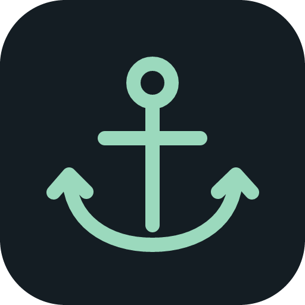
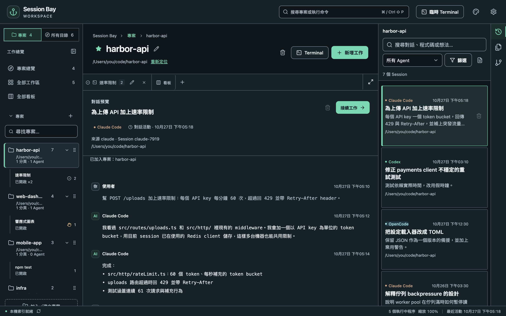

<div align="center">



# Session Bay

**找回開發脈絡，接著把事情做完。**

本機優先的桌面工作台：把各家 AI Coding Agent 的歷史對話集中起來，依專案整理，並內建真正的終端機、分割面板與 Git 工作台。

[官方網站](https://fullstackladder.dev/SessionBay/zh-tw/) · [下載](https://github.com/wellwind/SessionBay/releases) · [使用教學](https://fullstackladder.dev/SessionBay/zh-tw/guide/getting-started/) · [English](README.md)

</div>



## 為什麼需要

同一個專案，很少只用一個 Agent：Claude Code 寫程式、Codex 產生素材，額度用完時再切到 OpenCode 接其他免費模型。結果一個專案的脈絡散落在好幾個 Agent 裡，各自把歷史存在不同的地方。

Session Bay 會索引每個支援 Agent 的本機歷史，依專案集中起來。你可以搜尋、預覽，再一鍵在正確的目錄接續任何一段對話。

## 功能

- **所有 Agent 一份歷史**：支援 Claude Code、Codex CLI、OpenCode、Grok Build 與 Antigravity CLI。提供全文搜尋（支援中文）與 Agent／日期篩選，接續前可以先唯讀預覽。
- **以專案為中心**：釘選常用的資料夾；「所有目錄」頁仍列出每個跑過 Agent 的地方。
- **真正的終端機**：分頁與分割面板都是真的 PTY，Agent、開發伺服器和測試可以並排跑。
- **關掉視窗也繼續跑**：背景 broker 持有程序，重新開啟後會附接回原本還在執行的 Agent。
- **提醒通知**：Agent 等你回覆、完成或失敗時跳出系統通知，點一下就切到那個面板。可另行啟用合成音效、調整音量及逐一試聽（預設關閉）。[音效設定與勿擾限制](https://fullstackladder.dev/SessionBay/zh-tw/guide/settings/#提醒通知與音效)。
- **[看板](https://fullstackladder.dev/SessionBay/zh-tw/guide/kanban/)**：依專案規劃工作、附加 Agent Sessions，並在全部看板依階段追蹤所有已啟用看板。
- **Git 工作台**：diff 與部分暫存、commit、push／pull、歷史圖與 blame、分支、stash、worktree、三方衝突解決，以及 GitHub／自架 GitLab 的 PR。
- **拖放檔案與圖片給 Agent**、預覽工作區檔案與圖片，不用建專案也能開臨時終端機。
- **安全清理**：Session 先進回收筒；逐項確認要搬的檔案後，才會移到系統垃圾桶，之後也能還原。
- **主題與縮放**：深色／淺色主題、即時預覽，整個工作台共用一個縮放比例。
- **English／繁體中文**介面。

## 安裝

第一個預覽版支援 **Apple Silicon 的 macOS**（macOS 12 以上）。

1. 從[最新版本](https://github.com/wellwind/SessionBay/releases)下載 `Session.Bay_<版本>_aarch64.dmg`。
2. 打開映像檔，把 **Session Bay** 拖進「應用程式」。
3. 預覽版尚未經過 Apple 公證，第一次打開時會被 macOS 擋下。請到「系統設定 → 隱私權與安全性」按「強制打開」。圖文步驟見[安裝教學](https://fullstackladder.dev/SessionBay/zh-tw/guide/install/)。

Linux 與 Windows 可以自行從原始碼建置，但還沒有完成發行驗證。

## 隱私與資料安全

- 全部在本機執行：沒有帳號、沒有伺服器，也不蒐集使用資料。唯一的連網是向 GitHub Releases 檢查新版本，可以關閉。
- Agent 歷史一律**唯讀**。唯一的例外是「移到系統垃圾桶」：你逐筆檢查所有檔案並確認後，才會搬移。
- Agent 執行時仍沿用它自己的登入、網路與權限設定。

正式版資料使用 `dev.fullstackladder.sessionbay`（macOS：`~/Library/Application Support/dev.fullstackladder.sessionbay`）。新身分不會遷移舊版資料；macOS 首次開啟需要再次選擇「強制打開」，並重新授予通知權限。

## 從原始碼建置

需要 Node.js 24、Rust（版本由 `rust-toolchain.toml` 固定），以及所用平台的 [Tauri 前置需求](https://v2.tauri.app/start/prerequisites/)。

```bash
npm ci
npm run dev                 # 啟動桌面 App
npm run tauri -- build      # 建置目前平台的未簽章安裝包
```

`npm run dev` 使用獨立的 **Session Bay Dev** 設定檔（`dev.fullstackladder.sessionbay.dev`）；首次啟動會從正式版匯入設定與精選專案，並停用更新檢查。

測試與平台細節見 [Development](docs/development.md)（英文）。

## 狀態

Session Bay 目前是**早期預覽版**（`0.x`），難免還有粗糙的地方。遇到問題歡迎[開 issue](https://github.com/wellwind/SessionBay/issues)。

## 授權

[MIT](LICENSE) © Mike Huang
