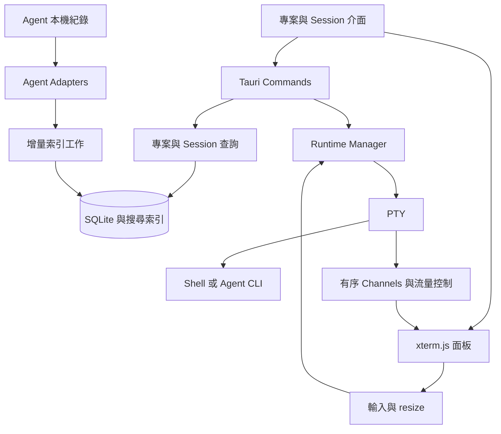

# Session Bay 技術架構

> 2026-10-16 實作更新：本次加入 Windows 原生支援；平台前提與待驗項目見[三平台支援](platform-support.md)。既有 macOS＋Linux P0 程式碼保留；以下仍保留規劃與驗收目標。實際通過項目、效能及未驗證平台見 [MVP 驗收紀錄](mvp-validation.md)，不能由檔案存在推定所有任務已完成。
目前實作採用 Tauri 2＋Rust 後端、React／TypeScript 前端、xterm.js、跨平台 PTY 與 SQLite。效能目標與各平台終端相容性仍按驗收清單逐項確認。

> 持續執行變更：PTY 所有權移至獨立本機 broker。桌面退出只 detach；輸出由 broker 有界消費，UI ACK 只限制 renderer。下方早期 UI-owned runtime／通道關閉即清理說明，以[持續 Runtime](persistent-runtime.md)與最新決策為準。

## 系統分工



Tauri Core 負責系統存取、資料庫、索引與程序。UI 仍在作業系統提供的 WebView 中執行 HTML、CSS 與 JavaScript；不同平台的 WebView 差異是驗證項目。[官方程序模型](https://v2.tauri.app/concept/process-model/)

## 建議技術組合

| 部分 | 候選技術 | 選擇理由與條件 |
| --- | --- | --- |
| 桌面框架 | Tauri 2 | 使用系統 WebView，適合 Rust 本機後端 |
| 前端 | TypeScript＋待選框架 | 保留介面客製化與宣告式元件模型 |
| 終端核心 | @xterm/xterm | 沿用控制序列、畫面緩衝與互動能力 |
| 終端擴充 | fit、search、web-links、webgl addons | 依實測與產品需求加入，保留 renderer fallback |
| PTY | portable-pty | 評估跨平台 Shell、Agent、resize 與退出處理 |
| 序列化 | serde 與 serde_json | 在 Rust 解析來源事件與交換結構化資料 |
| 並行執行 | Tokio 或受控 worker pool | I/O 與阻塞工作分開，限制掃描並行數 |
| 資料庫 | SQLite；rusqlite 或 SQLx 擇一 | 交易、分頁、migration 與本機搜尋 |
| 檔案監控 | notify 類型的 watcher | 監控搭配啟動補掃與定期 reconcile |

此表是候選組合，不表示依賴已安裝或相容性已驗證。前端框架、Rust crate 版本與正式目標平台在建立應用骨架前確認。

xterm.js 提供可選 GPU renderer 與擴充套件，但不是 Shell 或程序管理器。[xterm.js 官方說明](https://github.com/xtermjs/xterm.js) PTY 候選的跨平台抽象見 [portable-pty 文件](https://docs.rs/portable-pty/latest/portable_pty/)。

## 效能判斷

Tauri 不需隨應用附帶完整瀏覽器引擎，有利於發行體積；實際啟動時間、CPU 與總記憶體仍需量測。Rust 適合實作有界緩衝、串流解析與受控並行，但更換語言不會自動修正反覆全量掃描或過度 IPC。

Terminal 渲染仍由 xterm.js 與 WebView 承擔。Agent 子程序的資源消耗獨立統計；Session Bay 不能藉由更換桌面框架降低模型服務延遲或 Agent 自身工作量。

## 控制資料與終端資料

控制資料使用有型別的 Commands：列出專案、查詢 Session、讀取預覽、啟動、輸入、resize 與結束程序。來源狀態等低頻通知可以用 Events。

PTY 輸出使用有序 Channels。Tauri 官方指出 Events 不適合低延遲、高吞吐量資料，Channels 用於有序串流傳輸；應用仍需自行實作背壓與生命週期。[官方傳輸說明](https://v2.tauri.app/develop/calling-frontend/#channels)

### PTY 輸出路徑

1. 後端讀取位元組，短時間或大小門檻內合併輸出。
2. 傳送 runtime ID、序號與內容；量測編碼、序列化與複製成本。
3. 前端將資料直接寫入對應 xterm 實例。
4. 依消費進度回報額度，超過未消費上限時暫停讀取，讓背壓沿 PTY 傳遞。
5. 通道斷線或視窗關閉時依生命週期規則清理，不累積無限輸出。

批次上限、時間窗口與額度大小由原型調整。保持位元組或使用跨 chunk 的增量解碼，避免切斷 UTF-8 多位元字元。不得隨意刪掉控制序列、丟失順序或把 PTY 輸出當成普通文字行。

Terminal 輸出不進入一般 UI 全域狀態。隱藏分頁可以減少繪製，但需保留解析順序與有界畫面狀態，切回來不能失去已收到的內容。

## 增量索引流程

啟動時先開資料庫與讀取既有索引；背景 worker 再偵測來源與掃描差異。索引讀寫不阻擋鍵盤輸入與 UI 查詢。

- 記錄來源身份、檔案身份、大小、時間、已完成行的 byte offset 與解析器版本。
- 新增內容逐行解析，尾部未完成行留待後續，不把 offset 推進到半行後。
- 偵測截斷、替換與 rotation 時重新解析該檔，撤銷舊索引。
- watcher 訊號可合併與遺失；以目錄 reconcile 修正，不只依賴通知。
- 檔案刪除或封存移動時更新來源映射、主表與全文索引。
- 限制同時開啟檔案數、解析工作數與資料庫寫入批次。
- 查詢使用分頁與穩定排序，對話正文按需載入。
- 掃描只維護歷史與 cwd 分組，不自動將目錄加入側欄專案，也不覆寫使用者選擇與顯示名稱。

## 資料模型提案

| 實體 | 主要欄位 | 責任 |
| --- | --- | --- |
| AgentInstallation | id、kind、executable、version、capabilities | 工具可用性與啟動能力 |
| HistorySource | id、agentKind、root、health | 歷史資料來源身份 |
| Project | id、name、path、launchPath、curated、pinned、sessionCount | 目錄分組、執行位置與使用者明確選擇的側欄資格；實際傳輸欄位見 IPC 契約 |
| Session | id、sourceId、externalId、projectId、title、updatedAt、parentId、archived | 統一歷史 metadata |
| TranscriptSource | id、sessionId、path、fingerprint、offset、parserVersion | 來源檔案追蹤與去重 |
| MessageIndex | sessionId、sourceLocator、role、timestamp、searchText | 可重建的搜尋片段 |
| Runtime | id、paneId、installationId、sessionId、cwd、state、exitCode | 執行中程序的記憶體狀態 |
| Workspace | id、projectId、tabs、layoutVersion | 使用者的分頁與布局 |

Session 的唯一性以 agent、source 與 external ID 為基礎，不用標題或 cwd 作唯一鍵。來源移動由 mapping 協調；不同來源同 ID 保留歧義，不任意恢復。

Runtime handle 不寫成可在重開後直接附接的 PID。PID 可以重用；儲存布局不代表儲存活的程序。

### 自選專案與完整歷史分離

`Project` 同時承載 cwd 的穩定分組身份與 Session Bay 自有專案設定。新增 `curated: boolean` 明確表示使用者是否將此目錄加入左側專案；`pinned` 僅表示清單內的排序偏好，不能用是否有歷史推導加入狀態。

- `list_projects`／bootstrap 保留完整 catalog 分組。前端「專案」預設頁以 `curated` 篩選，「所有目錄」頁以 `sessionCount > 0` 篩選；後者包含已加入、未加入、未知及失效目錄。兩頁皆呈現總覽卡片與對應側欄。
- 總覽未選組時不發起混合 Session 清單查詢；選組後以該 `projectId` 查歷史，保留文字、Agent、日期、封存與子代理篩選。使用者明確進入全域搜尋後才省略 `projectId` 查詢跨目錄結果，此能力不作為兩頁總覽。`curated` 不是隱含搜尋條件。
- 初始掃描與新增 cwd 分組預設 `curated = false`。加入既有目錄、明確建立專案或預覽中的「加入專案」才改為 `true`；重新掃描／重建保留已保存狀態。
- schema migration 僅在升級時將舊版手動加入或 `pinned = true` 的項目設為自選，保留其名稱及 launch override；其他既有掃描項不自動加入。完成遷移後，不得在每次開庫或補掃時再次提升項目。
- 移出只設定 `curated = false` 並清除 `pinned`，不刪 Project 身份、Session／FTS 資料或工作區，不呼叫 Runtime 停止。後續掃描不得重建加入狀態。
- 已開啟工作區以其 project ID 在兩頁保留獨立導覽入口；即使對應目錄未加入、已移出或來源失效，也不能因側欄篩選而無法切回。來源失效仍按原有恢復預檢阻擋新啟動。

新增 `add_project` 的可選顯示名稱、`create_project` 與 `update_project` 的 `curated`／`name` 欄位。Rust 端驗證絕對目錄與單一新名稱，建立只對已存在的父目錄執行單層 `create_dir`；不得 `create_dir_all`、覆寫既有檔案／目錄或把名稱當 Shell 指令。加入既有 canonical 目錄沿用原 Project ID。顯示名稱變更只寫 Session Bay 的自有資料，不由 indexer 覆寫。

這些導覽操作不改 Session 原始 cwd、來源 transcript 或既有 `launchPath` 重新定位規則。測試僅使用隔離雲端的合成來源及暫存目錄，另驗證 schema 升級、重開、重掃、移出後查詢與 Runtime／工作區保留。

### 面板與布局

```ts
type PaneContent =
  | { kind: 'terminal'; profileId: string; cwd: string }
  | { kind: 'agent'; installationId: string; cwd: string; sessionId?: string };

type LayoutNode =
  | { kind: 'pane'; paneId: string }
  | {
      kind: 'split';
      axis: 'horizontal' | 'vertical';
      ratio: number;
      first: LayoutNode;
      second: LayoutNode;
    };
```

此型別是規格示意。配置資料與即時 xterm／PTY 物件分開保存；正式跨 Rust、TypeScript 型別契約在實作階段決定。

## 搜尋方案

SQLite 保存 metadata 與可重建的全文索引。FTS5 是候選能力，但其 tokenizer 必須配合中文與程式碼驗證。[SQLite FTS5 文件](https://sqlite.org/fts5.html)

MVP 至少支援中文子字串搜尋與常見程式碼識別字。評估 trigram 或其他 tokenizer；過短查詢可用受限範圍的參數化匹配 fallback。先量測召回率與延遲，再決定是否需要更複雜的搜尋引擎。第一版不依賴向量資料庫或模型 API。

## 共用工具登錄與偵測邊界

`src/agent-manifest.json` 是 TypeScript／Rust 共用的內建 provider metadata。UI 的工具名稱、標誌、能力卡片、選項及偵測資訊以此為來源；Rust 對照固定型別的 parser 與啟動驗證，不從設定載入未知程式碼。manifest 不能取代歷史 adapter、危險參數白名單或來源身份檢查。

Agent 安裝／版本重新偵測與歷史索引分離，Shell 偵測也只回傳候選。候選須由使用者加入 Profile 並保存；偵測不替換自訂 Profiles 或預設項。全新設定採有效絕對 `$SHELL` 或平台 fallback，參數 `[-l]`；不解析／匯入 Terminal 設定與 Shell rc，啟動檔由實際 Shell 載入。

## Agent 啟動計畫與選項邊界

五個 Agent kind 共用 Runtime；`grok` 對應 Grok Build，`antigravity` 對應 `agy` CLI。歷史能力另分開：五者以各自 adapter 進 catalog，OpenCode 的 SQLite 格式與限制見[整合說明](opencode-integration.md)；Antigravity 只解析 CLI 已觀察的持久化 step 與 metadata，未知格式以警告降級。Session 的 resumeDisabledReason 與 backend preflight 獨立控制可否接續；不能因 enum／history supported 就假定所有記錄都可恢復。

`Settings.agentOptions` 按工具保存 argv 與 opt-in，舊設定透過 serde 預設安全補齊。`launch_options` 集中驗證白名單、值、長度與危險選項；不接受任意 config、cwd、來源、身份或子命令覆寫。明確權限模式優先於危險預設，源頭仍由使用者勾選同意。

`preview_launch` 與 Runtime 啟動都呼叫 `Service::plan_launch`；預覽只回傳 executable、args、cwd，真正啟動重新預檢，再將完整 LaunchSpec 交給 PTY。索引 Session 以來源 env 隔離，手動 `resumeId` 與 catalog ID 互斥；不把手動 ID 誤標為已關聯歷史。argv 不經 Shell 解析，既有 cwd／launch override、程序所有權及退出清理規則保持一致。

Grok adapter 以 summary 與 authoritative updates stream 配對；跨檔 metadata 變動也需失效／重算，rewind 撤銷內容不得留在搜尋索引。來源唯讀，解析限制及缺檔／身份衝突降級見 [Agent 整合規格](agent-integrations.md)。

## 程序生命週期

Runtime Manager 擁有 PTY handle 與子程序監督責任；UI 元件 mount 或 unmount 不決定程序生死。狀態至少包括 starting、running、exited、failed、unknown。

切換分頁與退出 UI 保留 broker 擁有的程序；關閉面板則明確結束其受管程序。UI 關窗、重載或 channel 消失僅 detach，原生程序樹清理與超時處理仍需平台驗收。

前端收到 exit event 後更新 exited／failed 與結束碼，保留面板及有界最後畫面，包含結束碼 `0` 的普通 Shell。明確關閉面板才 stop／forget；移出專案與切換導覽不停止程序。

本批採內建 headless broker，使用 owner-only Unix socket／Windows named pipe，並以 attachment lease、snapshot-first replay 與有界輸出分離 UI 及程序生命週期。這項最高優先實作的原生驗收仍待完成；broker／OS 重啟後 metadata 為 interrupted，不憑舊 PID 收養程序。詳見[持續 Runtime](persistent-runtime.md)。

## MVP 後的用量資料流

P1 新增獨立的 usage 模組，分成「帳號額度 collector → QuotaSnapshot」與「歷史／即時 usage adapter → 正規化及去重 → UsageEvent → 可重建聚合」兩條資料路徑。額度百分比及帳號摘要不混入 Project／Session 事件加總。

Agent、provider、模型與帳號分開保存。事件以可靠來源 ID、request／Session 身份連到 catalog；帳號或專案未知時保持未歸屬。累計與 delta 明列語意，保留 cache／reasoning 包含關係，跨來源重疊無法核實時分開呈現。

新增 UsageAccount、QuotaSnapshot、UsageEvent、UsageMeasurement、PricingRule 與 UsageAggregate 的版本化 schema。自有資料可重建與刪除，原 CLI 歷史及登入資料維持唯讀；帳號憑證僅保存 OS 安全儲存區引用。

來源依支援版本評估官方介面、本機紀錄及選用的本機 OTel／OpenUsage 輸出。受控 worker 處理快取、刷新、退避與取消，不阻擋 PTY 或搜尋；去重 checkpoint 與寫入交易維持一致。價格規則保存生效區間與版本，計價失敗仍保留 token。

用量來源的資料生命週期與 indexer 協調：追加更新，截斷／替換重算，刪除來源清理事件與聚合；重新分組不複製事件。完整模型、時間規則及安全要求見[用量規格](usage-spec.md)。此模組不加入 P0 原型或 MVP 門檻。

## 本機資料與權限

- 原 Agent 歷史唯讀，Session Bay 的索引、設定與筆記存於自己的應用資料目錄。
- 對話索引同樣可能含敏感內容，限制本機檔案權限，預設不進版控、不上傳。
- 啟動使用 executable、args、cwd 與受控 env；不把不可信標題或路徑插入 Shell 字串。
- Transcript Markdown 與超連結以不可信內容處理，禁用任意 HTML 執行與自動外部資源載入。
- 終端輸出不能自行取得任意檔案或執行權限；剪貼簿控制序列等功能有明確政策。
- 來源刪除、取消索引與清除快取時，同步移除對話衍生資料。
- 自選專案屬自有設定；清除可重建索引保留其會員資格、名稱、釘選與重新定位。移出專案不是刪除來源或清除索引。
- 摘要、交接若需外部模型，另行設定並預覽傳送範圍。

## 建議模組邊界

未建立程式目錄；下列責任可在建立應用時映射成 Rust modules 與前端 features：

- agent adapters：來源格式、工具能力與啟動規格。
- catalog：專案與 Session 正規化、分組、查詢。
- indexer：來源追蹤、增量解析與 reconcile。
- runtime：PTY、輸入、resize、串流與程序清理。
- workspace：分頁、布局、命令與設定。
- storage：SQLite、migration、全文索引與索引重建。
- usage（P1）：額度 collector、usage 事件、去重、計價與多維度彙總。

## 驗證入口

先驗證 PTY → Channel → xterm 的往返路徑，再加入兩個可見面板與背景索引。效能量測應涵蓋 WebView 子程序，並將 Agent 子程序另外列出；完整計畫見[開發路線圖](roadmap.md)。


## 圖片輸入增量

ImageStaging 以分塊 IPC、持久私有檔案與跨程序獨占鎖管理圖片；broker launch record 提供 additive capability，UI 以 lease／generation 與 bracketed paste guard 避免誤送目標。設計及限制見 [圖片輸入](image-input.md)。
