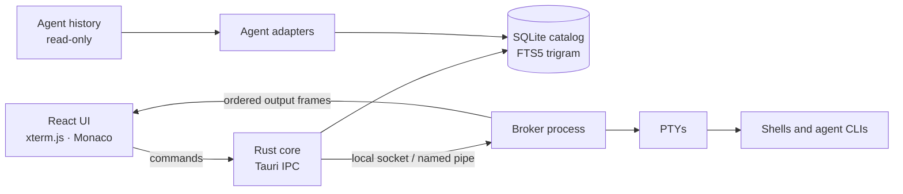

# Architecture

Session Bay is a [Tauri 2](https://v2.tauri.app/) desktop app: a Rust core with a React/TypeScript UI running in the system WebView.

## Source layout

| Path | Responsibility |
| --- | --- |
| `src/` | React UI: projects, history, terminals, Git, settings |
| `src/agent-manifest.json` | Built-in agent registry shared by TypeScript and Rust (names, executables, resume templates) |
| `src-tauri/src/desktop.rs` | Tauri commands (the IPC surface) |
| `src-tauri/src/service.rs` | Application service behind the commands |
| `src-tauri/src/catalog.rs` | SQLite catalog, migrations and search |
| `src-tauri/src/adapters.rs`, `opencode.rs`, `antigravity*.rs` | Per-agent history readers |
| `src-tauri/src/broker/`, `runtime/` | Background broker, PTY ownership and reattach |
| `src-tauri/src/git/` | Git workbench (runs the `git` CLI) and GitHub/GitLab hosting |
| `src-tauri/src/os_trash.rs` | Moving sessions to the system trash and restoring them |
| `src-tauri/tests/` | Integration tests, all on synthetic data |

## History index

- Each agent has a typed adapter. There is no plugin system: an agent without an adapter has no history support.
- Adapters parse append-only files incrementally. They track file identity, size, mtime and the byte offset of the last complete line, and re-parse a file when it is truncated or replaced.
- A file watcher triggers rescans, and periodic reconciliation covers missed events.
- Session identity is agent + source + external ID, never title or cwd.
- Sessions are grouped by their recorded working directory. Scanning never adds a folder to the user's project list.
- Search uses an FTS5 trigram index to pick candidates, then verifies exact substring matches. This handles CJK text without a tokenizer. Queries shorter than three characters fall back to a scan.
- The catalog lives in the app data directory (`~/Library/Application Support/dev.fullstackladder.sessionbay` on macOS). It can always be rebuilt from the sources, except for Session Bay's own data: projects, display names, the recycle bin and trash records.

## Runtime and broker

Terminals are owned by a separate **broker** process (`src-tauri/src/bin/sessionbay-broker.rs`), not by the window.

- Closing the UI only detaches. When the window reopens, it reattaches to the same runtime and never re-runs the launch command.
- Only one broker can serve a data directory; it holds an OS file lock.
  - On Unix, the socket and its directory are private to the user (0700/0600).
  - On Windows, the named pipe uses a DACL that grants access only to the current user's SID.
- The broker keeps a bounded replay of each terminal: up to 1 MiB, 200 lines of scrollback and a vt100 screen model.
- Output reaches the UI as ordered, acknowledged frames, so a slow renderer applies backpressure instead of growing memory without bound.
- Metadata stores runtime IDs, pane, project, agent, cwd and state. It never stores PIDs, argv, environment variables or terminal content.
- If the broker or the machine restarts, panes show `interrupted`. The user has to explicitly start them again.

## Process launch

Processes are always launched as `executable` + `args` + `cwd` passed separately; untrusted text is never concatenated into a shell command.

Each agent can have saved custom arguments. High-risk permission modes are off by default and must be enabled per agent. Before launching, the UI shows the exact argv generated by the backend.

## Agent activity

Session Bay can show whether an agent is working, waiting for input, done or failed. The signals come from:

- an opt-in Claude Code mod and OpenCode plugin;
- Codex's app-server state;
- the OSC 7501 terminal status sequence.

These signals drive the tab badges and the system notifications.
