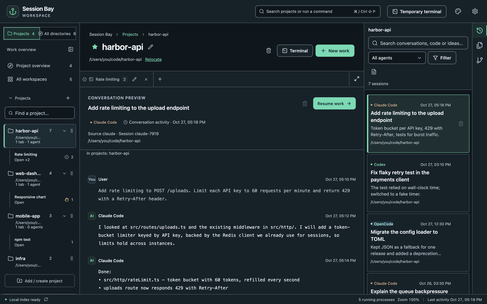

## Projects and directories

- **Projects** lists only the folders you added. It is your everyday list.
- **All directories** lists every folder where any agent has history, including ones you never added and folders that no longer exist.

Add a folder from its card in **All directories** (**Add project**), or choose **Add / create project** to add an existing folder or create a new one. Removing a project from the list never deletes files, history or running processes.

## Search a project's history

Open a project, then choose **Sessions** in the tool bar on the right (or press <kbd>⌘</kbd><kbd>⇧</kbd><kbd>F</kbd>).

- Search matches any part of a conversation, including Chinese, Japanese and code identifiers.
- **All agents** narrows the list to one agent; **Filter** adds a date range, archived sessions and subagents.
- Clicking a session only **previews** it. Nothing starts until you choose **Resume work**.

To search every folder at once, go to **All directories** and choose **Search all sessions**.

## Resume

**Resume work** starts the original agent in the session's working directory, for example `claude --resume <id>`. The agent uses its own login and permissions.

If a project moved, choose **Relocate** next to its path. The original history is not rewritten; Session Bay only starts new processes in the new location.

## Quick open

Press <kbd>⌘</kbd><kbd>⇧</kbd><kbd>P</kbd> to open the command palette and jump to any project, tab, session or file.
