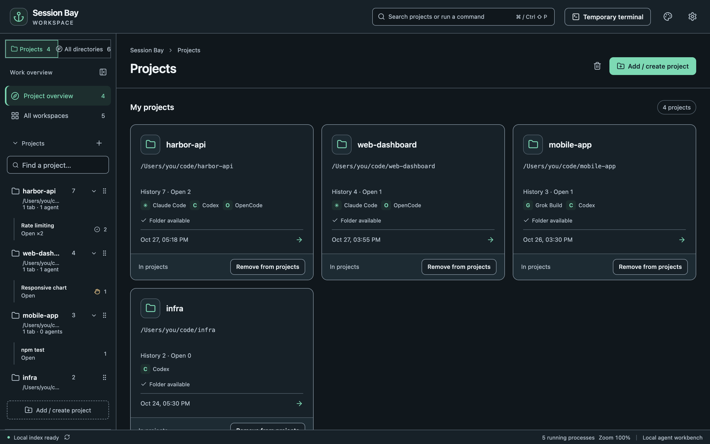

Session Bay is a desktop workbench for AI coding agents. It reads the history that your agents already keep on disk, organizes it by project, and gives you real terminals to keep working, all on your own machine.

## In five minutes

1. [Install Session Bay](/SessionBay/guide/install/) and open it.
2. The first launch opens **Settings**. Session Bay already knows where each agent keeps its history; check that the agents you use are enabled, then choose **Save and start scanning**.
3. Open **All directories** to see every folder where you ran an agent, and add the ones you care about to **Projects**.
4. Pick a project, choose **Sessions** in the right-hand tool bar, and click a conversation to preview it.
5. Choose **Resume work**. The agent starts in the original folder with the same session.

## Words used in this guide

| Term | Meaning |
| --- | --- |
| **Project** | A folder you added to your project list. Removing a project never deletes files or history. |
| **Session** | One conversation with an agent, read from that agent's own history. |
| **Workspace** | The tabs and panes that are open for a project. |
| **Pane** | One terminal running a shell or an agent. A tab can split into several panes. |

## Supported agents

Claude Code, Codex CLI, OpenCode, Grok Build and Antigravity CLI. See [Supported agents](/SessionBay/reference/supported-agents/) for versions and where history is read from.
