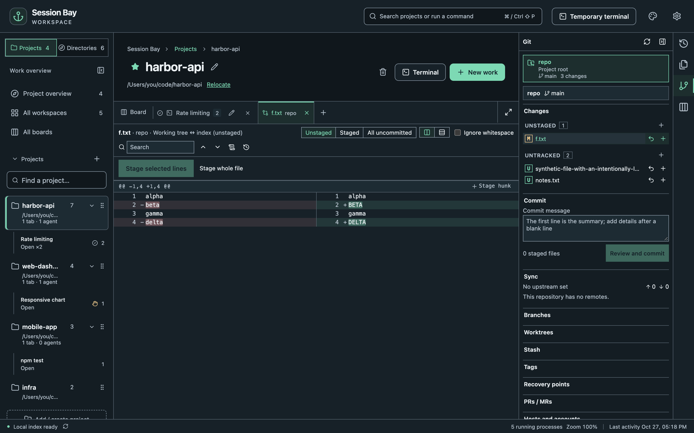

Open a project and choose **Git** in the tool bar on the right. Session Bay detects the enclosing repository and scans project subfolders, using your installed `git` for every action. The subfolder scan has depth and resource limits, so deeply nested repositories may not appear until you open a file from them.

## Changes and commits

- Click a changed file to see its diff side by side or inline.
- Select single lines or hunks and stage only those.
- **Review and commit** shows exactly what will be committed, which hooks will run and whether the commit is signed.
- **Fetch**, **Pull** and **Push** show the remote and branch before anything happens. Tags are only pushed when you push them explicitly.

## History, branches and more

- **History** opens a commit graph with search and filters; **Blame** shows who changed each line.
- Create, switch, merge and delete **branches**; manage **stashes**, **tags** and **worktrees**.
- **Reset** and **Revert** explain their effect before they run.

## Safe by default

Destructive local operations such as reset, discard and branch deletion create a **recovery point** first. Restore it from **Recovery points** if something went wrong.

Force push uses **force-with-lease**, checking the remote commit you reviewed before moving the remote branch. It does not create a local recovery point for remote commits.

## Conflicts

When a merge, rebase or cherry-pick stops on conflicts, open the file to see base, ours and theirs, pick a side per block or edit the result, then **Mark as resolved** and **Continue**.

## Pull requests

Add a GitHub or self-hosted GitLab account under **Hosts and accounts**. Tokens are stored in your system credential store, never in Session Bay's settings. Then you can list, create, review, approve and merge pull requests. Reviews and merges are tied to the exact commit you looked at.
