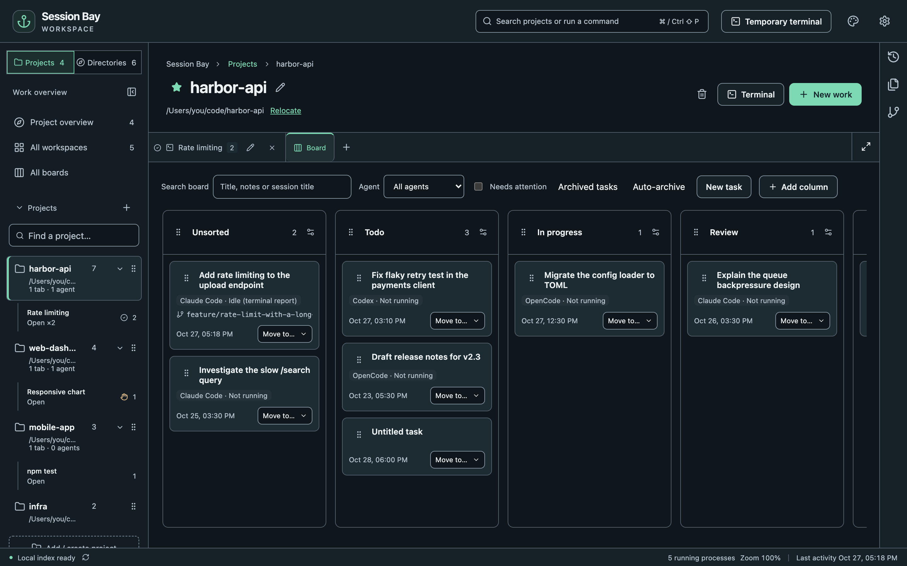
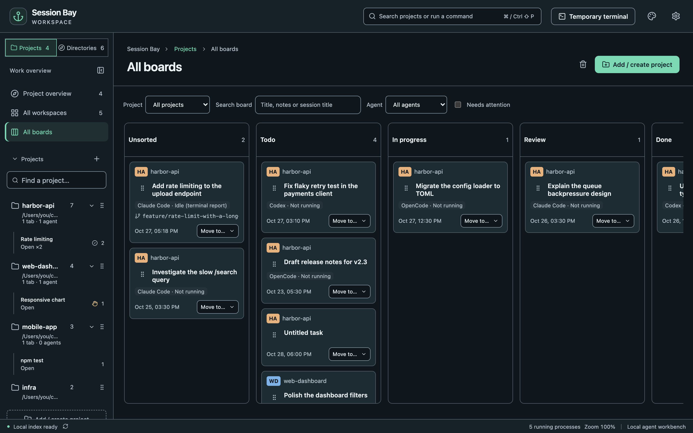

## Enable a project board

Open a project from **Projects**, select the **Board** tab beside its workspace tabs, then choose **Enable board**. Only projects you have added to Projects can have a board; add a directory there first if it only appears in All directories.

Each card represents a task and can hold zero or more agent sessions. Choose **New task** to plan work before starting an agent. New sessions enter **Unsorted** after you enable the board. Older history stays outside the board until you resume it or use **Attach from history** in a task's details. Child sessions follow their parent task.

Board data stays in Session Bay's local catalog, survives index rebuilds and is never written into the project folder or agent history.

## Columns, stages and movement

The default columns are **Unsorted**, **Todo**, **In progress**, **Review** and **Done**. Use **Add column** or a column's settings to rename, reorder or add columns and choose their stage. Unsorted and Done are system columns: you can rename and reorder them, but their stage is fixed and they cannot be deleted. Deleting another column requires choosing a destination for all its tasks, including archived ones.

Drag a card to reorder it or move it to another column. Use its **Move to…** menu for the same actions without dragging. On the card's drag handle, **Alt+Up/Down** changes order and **Alt+Left/Right** changes column. Press **Escape** to cancel a drag.

Movement is manual. An agent finishing a turn does not move its task to Done.

## Task details and sessions

Select a task title to edit its title and notes, attach an older session, or resume an attached session. Save changes before starting work.

**Start work** opens the existing agent or shell launcher in the project's folder, or in the task's linked worktree. The task title and notes are inserted into the terminal input **without being sent**, once safe paste mode is available. Review them before pressing Enter. If safe paste mode is unavailable, use **Copy task text** instead. Plain shells do not create an indexed agent session.

You can merge tasks by dropping one on the center of another in a project board, or choosing a target in task details. Review the confirmation: sessions and notes move to the target and the source task is deleted. Use **Split into new task** on an attached session to separate it again. Merging never crosses projects.

Linked worktree sessions belong to the main project's board and show their branch. **Create worktree** in task details binds the new checkout to that task so sessions started there attach automatically.

## All boards

Choose **All boards** below **All workspaces** in the sidebar to see tasks from every enabled project board in five fixed stage columns. Custom and renamed project columns are grouped by their stage. Each card shows its project's color, initials and name.

Filter by **Project**, text, **Agent**, and **Needs attention**. Text matches task titles, notes and attached session titles. Needs attention uses the attached sessions' live input/permission or error status. You can combine all four filters.

Drag a card to another stage, use **Move to…**, or press **Alt+Left/Right** on its handle. The card goes to the **first column for that stage in its own project's column order**, after that column's existing tasks. A destination is unavailable when that project has no column for the stage. Dropping over a different project's card still changes only the stage; it does not merge the cards or change the task's project.

Task details, start and resume also work from this overview. Use the project board to change columns or reorder cards within a column.

## Done, archive and cleanup

A Done task offers three separate actions:

- **Archive task** hides it while keeping its sessions. Open **Archived tasks** on the project board to restore it.
- **Delete task** removes the card and lets you return its sessions to Unsorted or leave them off the board. History is untouched.
- **Recycle attached sessions…** uses the existing per-session confirmation flow. Recycled sessions are hidden from the task and return if restored.

**Auto-archive** on the project board can archive Done tasks after a chosen number of days without task changes. It is off by default. Archived tasks are hidden from All boards.

If a session's source is confirmed missing or the session is moved to the system trash, its link is removed; the task remains, even if it becomes empty. None of these board operations rewrites agent history.
