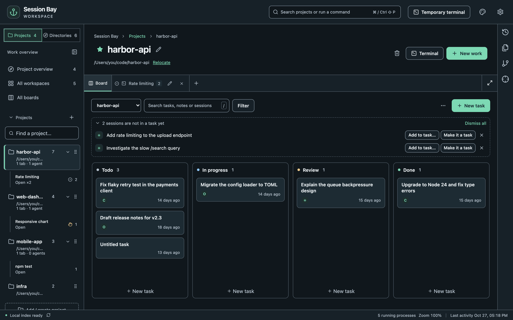
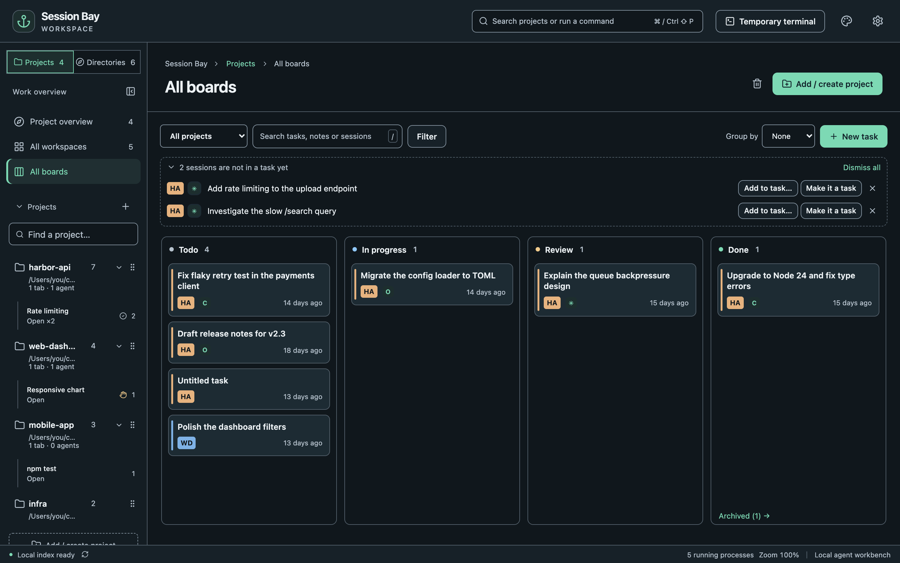

A board turns agent work into tasks. Write down what you want done, start an agent from the task, and the sessions it creates stay attached so you can come back to them.

## Enable a project board

Open a project from **Projects**, choose **Focus** in the right activity bar, then choose **Enable board**. Afterwards, **Open board** in the Focus panel or the **Open board** command in the command palette opens the full board; select a workspace tab to return to your terminals. Only projects you have added to Projects can have a board; add a directory there first if it only appears in All directories.

Board data stays in Session Bay's local catalog, survives index rebuilds and is never written into the project folder or agent history.

## Four stages

Every board has the same four columns: **Todo**, **In progress**, **Review** and **Done**. You can rename a column from its **⋯** menu; columns cannot be added, deleted or reordered, so every board, and **All boards**, reads the same way.

Boards from earlier versions that had extra columns are folded into these four the first time the new version opens the catalog. Tasks keep their order and are appended to the default column of the same stage; custom column names are not kept.

Drag anywhere on a card to reorder it or move it to another column; a click opens its details. With a card focused, **Alt+Up/Down** changes order and **Alt+Left/Right** changes stage. The drawer's **Stage** menu moves a task without dragging. Drag near an edge to scroll toward off-screen tasks and columns, and press **Escape** to cancel. Moves offer **Undo** for about six seconds.

Cards stay quiet: they show the agents involved and the last update. A session's state appears only while it is working, waiting for you or reporting an error, and a waiting or failed session highlights its card. **Needs attention** appears in the toolbar while any task needs you and filters the board to those tasks.

With focus inside the board, **N** opens New task and **/** focuses search. These keys do not intercept typing or IME composition.

## Suggestions

After you enable a board, new sessions in the project that are not part of a task appear above the columns as suggestions. For each one you can:

- **Add to task…** attaches its sessions to an existing task. The task keeps its own title and notes.
- **Make it a task** moves it to Todo as a new task.
- **Dismiss** (×) takes it off the board. It is not suggested again; you can still attach it later with **Attach from history**.

**Dismiss all** asks for confirmation first. The suggestions bar collapses to a single line. Sessions you start from a task attach to that task directly and never become suggestions. Older history stays off the board until you resume it.

## Task details and starting work

Select a card to open its details drawer. The title receives focus. Title and notes save automatically shortly after you stop typing, and before you close the drawer or start work; if saving fails, the drawer stays open with **Not saved. Try again**.

The primary button depends on the task:

- **Continue with <agent>** resumes the task's latest session. Its **▾** menu offers **Start a new session**.
- **Start work** opens the New work launcher when the task has no sessions yet.

Starting a task that is in Todo moves it to **In progress**, with Undo. This is the only automatic move; an agent finishing a turn never moves a task.

Starting opens the launcher in the project folder, or the task's linked worktree. The task title and notes are inserted into the terminal input **without being sent**, once safe paste mode is available. Review them before pressing Enter. If safe paste mode is unavailable, use **Copy task text** instead. Plain shells do not create an indexed agent session.

Automatic attachment from a new launch needs a trusted session ID from the agent and one enabled history source for that agent. Some status integrations, hooks-disabled launches and older brokers do not supply that ID. If the session does not attach automatically, use **Attach from history**, which lists recent project sessions and can be filtered. Sessions in a task's bound worktree also attach by their working directory.

Each attached session has **Resume**; its **⋯** menu offers **Split into new task**. The task's **⋯** menu holds **Merge into another task…**, **Create worktree for task**, **Archive task** (Done only), **Recycle attached sessions…** and **Delete task…**. Merging asks for confirmation: sessions and notes move to the target and the source task is deleted. Merging never crosses projects.

Linked worktree sessions belong to the main project's board and show their branch. **Create worktree** binds the new checkout to the task so sessions started there attach automatically.

## Focus panel

Choose **Focus** in the right activity bar, or press **Mod+Shift+K** (⌘ on macOS, Ctrl elsewhere). It sits next to your terminals and answers what needs you next in the current project:

- **Needs you** lists tasks with a session waiting for input or permission, or reporting an error. **Go to terminal** brings that session's terminal forward.
- **In progress** lists tasks in progress. **Go to terminal** or **Resume** returns to their latest session.
- **Up next** shows the first three Todo tasks with **Start**, followed by a quick **New task** field.

The activity icon shows how many active tasks need you. **Open board** opens the full board; a link also shows how many sessions are waiting to be filed. If the board is disabled, the panel offers **Enable board**.

## All boards

Choose **All boards** in the sidebar to see every enabled project board in the same four stages. Use the **scope** menu at the start of the toolbar to switch between all projects and a single project's board. In **Group by: None**, each card shows its project's color and initials. **Group by: Project** gives each project its own lane.

Search covers task titles, notes and attached session titles. **Filter** narrows by agent; active filters appear as removable chips.

Dragging a card or pressing **Alt+Left/Right** changes its stage within its own project. Dropping it on another project's card changes only the stage; it never merges cards or changes the task's project. **New task** asks which project the task belongs to. Details, start and resume work here too.

## Done, archive and cleanup

A Done task offers three separate actions in its **⋯** menu:

- **Archive task** hides it while keeping its sessions. Manual archives offer a six-second **Undo**. Select **Archived (n) →** below the Done column to see archived tasks and restore them.
- **Delete task…** removes the card and lets you suggest its sessions again or leave them off the board. History is untouched.
- **Recycle attached sessions…** uses the existing per-session confirmation flow. Recycled sessions are hidden from the task and return if restored.

**⋯ → Auto-archive…** on the project board can archive Done tasks after a chosen number of days without task changes. It is off by default. Done columns show five tasks at first.

If a session's source is confirmed missing or the session is moved to the system trash, its link is removed; the task remains, even if it becomes empty. None of these board operations rewrites agent history.
