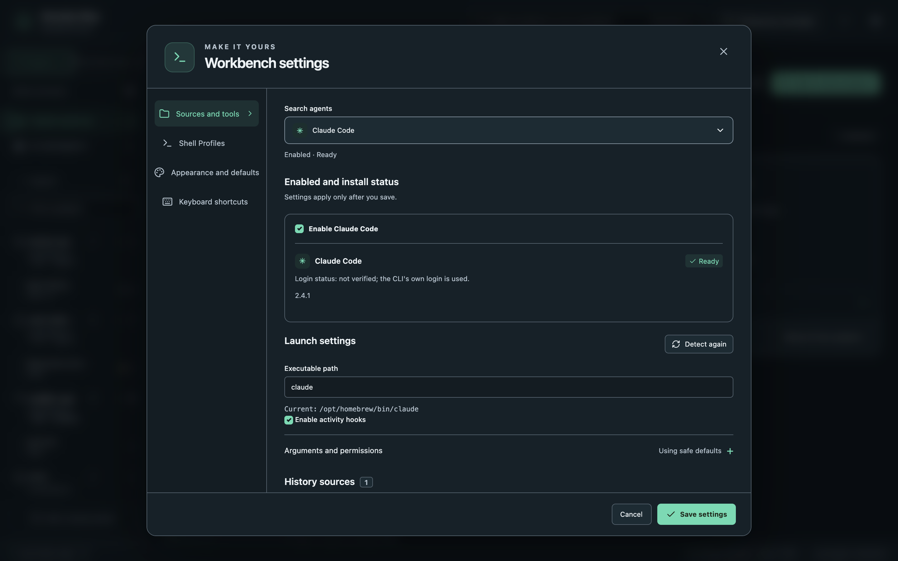

Open **Settings** with the gear icon in the top bar.

## Sources and tools

Each agent has its own card:

- **Enable** the agents you use. Disabled agents keep their indexed history but are not scanned or launched.
- **Executable path**: Session Bay looks in common install locations. Apps on macOS do not inherit your shell's `PATH`, so set an absolute path if an agent is not found.
- **Arguments and permissions**: extra launch arguments as a JSON array, for example `["--model", "your-model"]`. High-risk modes that skip permission prompts are off by default and must be enabled per agent.
- **History sources**: the folders history is read from. **Detect history sources** checks the official locations.

## Shell profiles

Choose which shell and arguments new terminals use, and add environment variables.

## Appearance and defaults

- **Language**: English, 繁體中文, or follow the system language. Changing it reloads the window; terminals reconnect.
- Interface and terminal themes, palettes, fonts and workbench zoom (<kbd>⌘</kbd><kbd>+</kbd> / <kbd>⌘</kbd><kbd>-</kbd> / <kbd>⌘</kbd><kbd>0</kbd>).
- The default agent and shell profile for **New work**, and system notifications.

## Keyboard shortcuts

Change the shortcuts for common commands. `Mod` means <kbd>⌘</kbd> on macOS.
