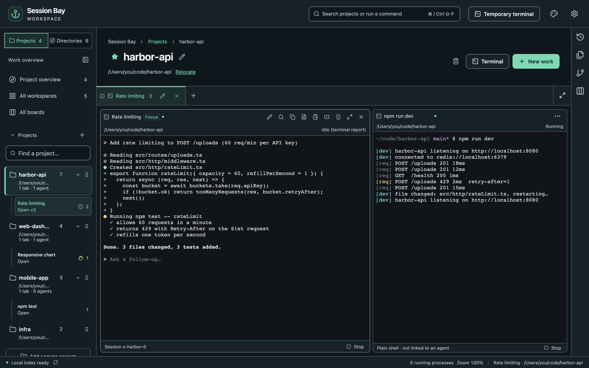
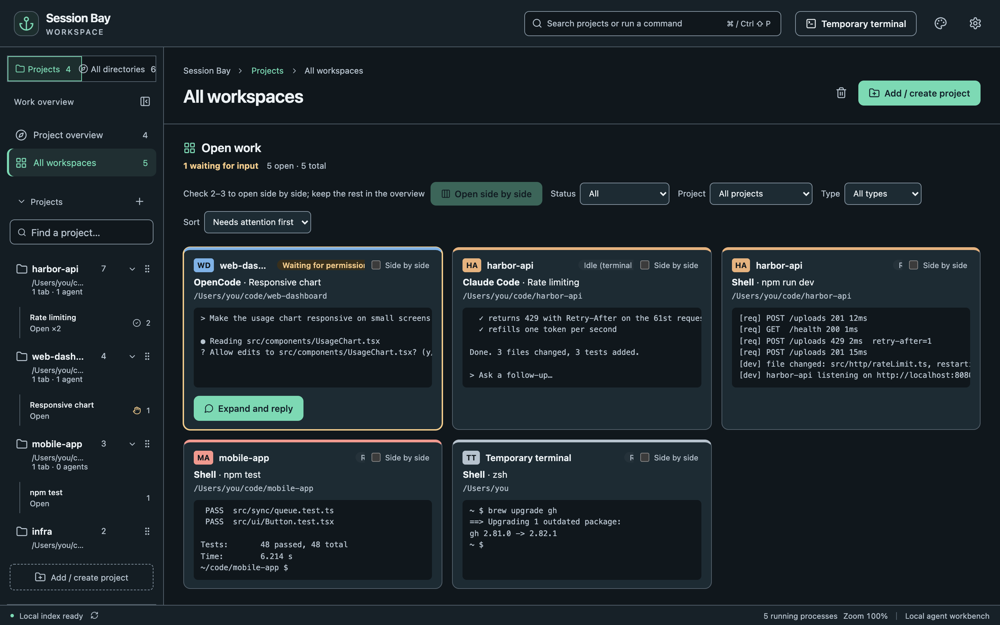

## Start work

In a project, choose **New work** and pick:

- **Agent** to start a new agent conversation, or
- **Shell** for a regular terminal using your shell profile.

Before starting an agent, the dialog shows the exact command line and folder that will be used.

**Terminal** opens a shell straight away. **Temporary terminal** in the top bar opens a shell in your home folder without a project.

## Split and arrange

- Use the pane buttons to split **left and right** or **top and bottom**.
- Drag the divider to resize, or use the maximize button on a pane.
- Tabs can be reordered and renamed. <kbd>⌘</kbd><kbd>1</kbd>–<kbd>9</kbd> switch tabs.
- In a split, choose **Existing work** to move a pane from another tab, or resume a session right inside the split.

## Close the window, keep working

Terminals belong to a background process (the *broker*), not to the window. Closing Session Bay leaves your agents and dev servers running. When you reopen it, every pane reattaches to the same process with its recent output.

Terminals keep up to **10,000 lines of scrollback**. Reattaching restores the current screen and up to **1 MiB of the newest scrollback output**; older output may no longer be available.

- **Stop** ends a pane's process. Closing a pane asks before stopping it.
- After a restart of your Mac, panes show **interrupted**; start them again when you are ready.

## Files and images for agents

Drag files or images onto an agent pane, or paste them, to hand them to Claude Code, Codex, Grok Build or OpenCode. Paths are inserted but not sent, so you can add a request before pressing Enter.

## See everything at once

**All workspaces** in the sidebar shows every open pane across projects with its latest output. Agents that need you are listed first.

