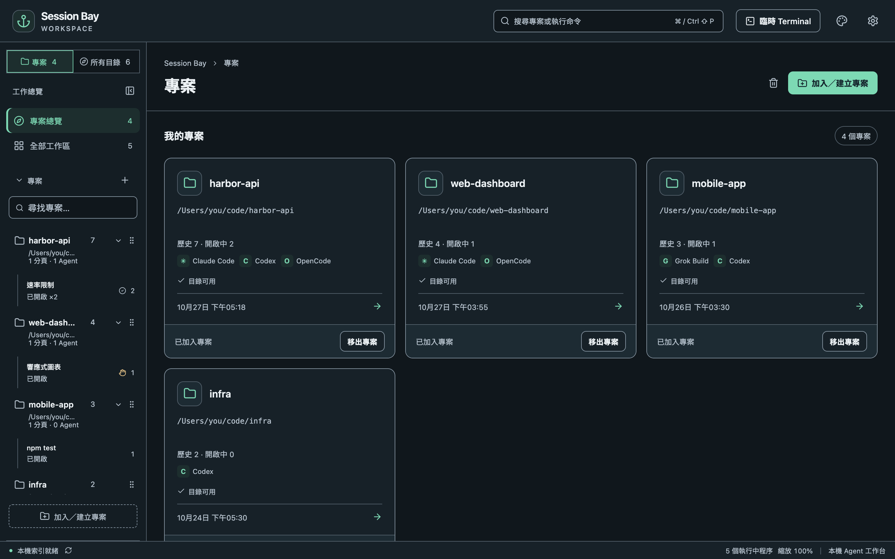

Session Bay 是給 AI Coding Agent 用的桌面工作台。它讀取各 Agent 本來就存在電腦上的歷史，依專案整理，並提供真正的終端機讓你繼續工作，全部都在你自己的電腦上執行。

## 五分鐘上手

1. [安裝 Session Bay](/SessionBay/zh-tw/guide/install/) 並打開。
2. 第一次啟動會打開**設定**。Session Bay 已經知道各 Agent 的歷史放在哪裡，確認你用的 Agent 都已啟用，然後按**儲存並開始掃描**。
3. 打開**所有目錄**，可以看到每個跑過 Agent 的資料夾，把常用的加入**專案**。
4. 選一個專案，在右側工具列選**歷史 Sessions**，點一段對話即可預覽。
5. 按**接續工作**。Agent 會在原本的資料夾、用同一個 Session 啟動。

## 本教學用到的名詞

| 名詞 | 意思 |
| --- | --- |
| **專案** | 你加入專案清單的資料夾。移出專案不會刪除任何檔案或歷史。 |
| **Session** | 與 Agent 的一段對話，從該 Agent 自己的歷史讀取。 |
| **工作區** | 某個專案目前開著的分頁與面板。 |
| **面板** | 一個執行 Shell 或 Agent 的終端機。一個分頁可以分割成多個面板。 |

## 支援的 Agent

支援 Claude Code、Codex CLI、OpenCode、Grok Build 與 Antigravity CLI。版本與歷史位置見[支援的 Agent](/SessionBay/zh-tw/reference/supported-agents/)。
