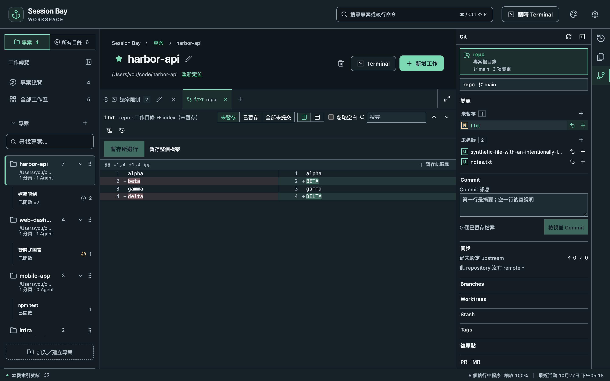

打開專案，在右側工具列選 **Git**。Session Bay 會找出專案內的每個 Git repository，所有操作都使用你電腦上安裝的 `git`。

## 變更與 commit

- 點選變更的檔案，可以並排或行內檢視 diff。
- 選取單行或整個區塊，只暫存你要的部分。
- **檢視並 Commit** 會列出實際要 commit 的內容、會執行的 hooks，以及是否簽章。
- **Fetch**、**Pull**、**Push** 執行前都會先顯示 remote 與分支。Tag 只有在你明確推送時才會推送。

## 歷史、分支與更多

- **歷史**會開啟 commit 圖，可以搜尋與篩選；**Blame** 顯示每一行由誰修改。
- 建立、切換、合併與刪除**分支**；管理 **stash**、**tag** 與 **worktree**。
- **Reset** 與 **Revert** 執行前會先說明影響。

## 預設就安全

有風險的操作（reset、捨棄變更、刪除分支、強制推送）會先建立**復原點**。出問題時可以從**復原點**還原。

## 衝突

合併、rebase 或 cherry-pick 因衝突停下時，打開檔案可以看到共同祖先、我方與對方的版本。逐區塊選擇採用哪一邊或直接編輯結果，然後按**標記為已解決**，再按 **Continue**。

## Pull Request

在**主機與帳號**加入 GitHub 或自架 GitLab 帳號。Token 存在系統的安全憑證儲存，不會寫進 Session Bay 的設定。之後就能列出、建立、review、核准與合併 PR，review 與合併都會綁定你看過的那個 commit。
