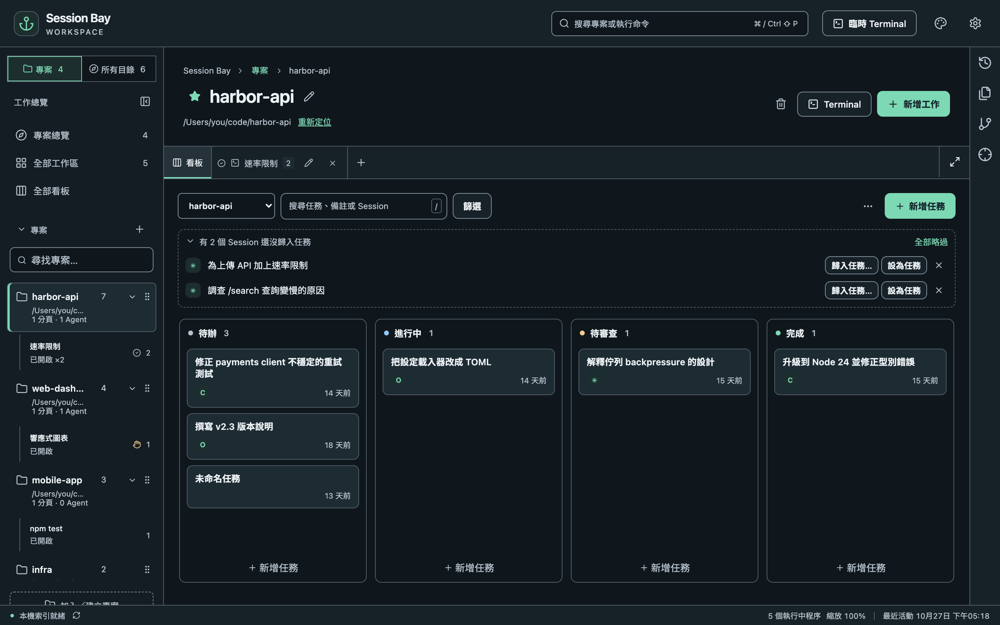
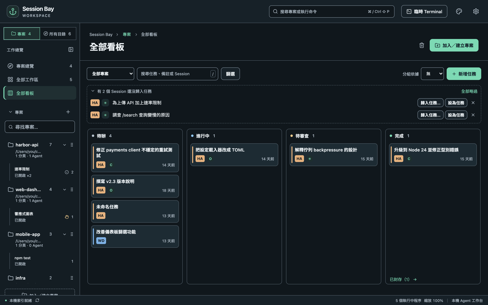

看板把 Agent 工作變成任務。寫下想完成的事，從任務啟動 Agent，它產生的 Sessions 會留在任務上，方便之後回來接續。

## 啟用專案看板

從**專案**開啟專案，選擇專案分頁列最前面的**看板**，再按**啟用看板**。只有加入「專案」的目錄能啟用看板；若目錄只出現在「所有目錄」，請先將它加入專案。

看板資料只儲存在 Session Bay 的本機目錄資料庫，重建索引後仍保留，不會寫入專案資料夾或 Agent 歷史紀錄。

## 四個階段

每個看板都有相同的四個欄位：**待辦**、**進行中**、**待審查**與**完成**。可以從欄位的 **⋯** 選單重新命名；欄位不能新增、刪除或重新排序，讓每個看板與**全部看板**讀起來都一樣。

舊版建立、含有額外欄位的看板，會在新版第一次開啟目錄資料庫時合併成這四個欄位。任務會保留原本的順序，接在同一階段的預設欄位之後；自訂的欄位名稱不會保留。

從卡片任意位置拖曳即可排序或移到其他欄位；點一下則開啟詳情。卡片取得焦點時，按 **Alt+上／下方向鍵**調整順序，按 **Alt+左／右方向鍵**變更階段。詳情抽屜的**階段**選單也能移動任務，不必拖曳。拖曳到邊緣時會自動捲動，按 **Escape** 取消拖曳。移動後約六秒內可按**復原**。

卡片保持簡潔：只顯示參與的 Agent 與最後更新時間。Session 只有在工作中、等待你或回報錯誤時才會顯示狀態；等待或失敗的 Session 會讓卡片醒目標示。只要有任務需要你，工具列就會出現**需要處理**，按下後只顯示這些任務。

焦點位於看板內時，按 **N** 開啟新增任務、按 **/** 聚焦搜尋。這些按鍵不會攔截文字欄位或輸入法組字。

## 建議

啟用看板後，專案中尚未屬於任何任務的新 Sessions 會以建議的形式顯示在欄位上方。每一項都可以：

- **歸入任務…**：把它的 Sessions 附加到既有任務，任務的標題與備註保持不變。
- **設為任務**：移到待辦，成為新的任務。
- **略過**（×）：從看板移除，之後不會再被建議；仍可用**從歷史附加**加入任務。

**全部略過**會先要求確認。建議列可以收合成一行。從任務啟動的 Sessions 會直接附加到該任務，不會成為建議。較舊的歷史紀錄在你接續之前不會進入看板。

## 任務詳情與開始工作

點選卡片會開啟詳情抽屜，並聚焦標題。標題與備註會在你停止輸入後不久自動儲存，關閉抽屜或開始工作前也會先儲存；儲存失敗時，抽屜會保持開啟並顯示**尚未儲存，重試**。

主要按鈕會依任務狀態變化：

- **繼續 <Agent> 工作**：接續任務最新的 Session。旁邊的 **▾** 選單提供**開新 Session**。
- **開始工作**：任務還沒有 Session 時，開啟新增工作的啟動介面。

從待辦開始的任務會移到**進行中**，並可復原。這是唯一的自動移動；Agent 完成一輪回覆不會移動任務。

開始工作會在專案資料夾或任務綁定的 worktree 開啟啟動介面。終端機提供安全貼上模式後，任務標題與備註會插入輸入區，**不會送出**；請先檢查再按 Enter。若無法使用安全貼上模式，可以改按**複製任務內容**。一般 Shell 不會建立可索引的 Agent Session。

新啟動的 Session 要自動附加到任務，必須由 Agent 提供可信任的 Session ID，且該 Agent 只能有一個啟用的歷史來源。部分狀態整合、未啟用 hooks 的啟動方式與舊版 broker 不會提供此 ID。若未自動附加，請使用**從歷史附加**，它會列出專案最近的 Sessions，並可篩選。任務綁定的 worktree 中的 Sessions，也會依工作目錄自動附加。

每個附加的 Session 都有**接續**；它的 **⋯** 選單提供**拆成新任務**。任務的 **⋯** 選單包含**合併到其他任務…**、**為任務建立 worktree**、**封存任務**（僅限完成）、**將附加的 Sessions 移至資源回收筒…**與**刪除任務…**。合併前會要求確認：Sessions 與備註會移到目標任務，來源任務會被刪除。合併不會跨越專案。

連結的 worktree 中的 Sessions 屬於主專案看板，並顯示分支。**建立 worktree** 會將新 checkout 綁定到任務，之後在其中啟動的 Sessions 會自動附加。

## 焦點面板

點選右側活動列的**焦點**，或按 **Mod+Shift+K**（macOS 使用 ⌘，其他平台使用 Ctrl）。面板位在終端機旁，告訴你目前專案接下來需要處理什麼：

- **需要你**：列出有 Session 等待輸入、權限確認或回報錯誤的任務。**前往終端機**會帶出該 Session 的終端機。
- **進行中**：列出進行中的任務。**前往終端機**或**接續**會回到最新的 Session。
- **接下來**：顯示待辦的前三項，各有**開始**按鈕，下方提供快速**新增任務**。

活動圖示會顯示需要你的任務數。**開啟看板**會開啟完整看板；面板也會顯示有多少 Sessions 等待歸入任務。尚未啟用時，面板提供**啟用看板**。

## 全部看板

從側邊欄選擇**全部看板**，即可用相同的四個階段查看每個已啟用的專案看板。工具列最前面的**範圍**選單可在全部專案與單一專案看板之間切換。**分組依據：無**時，每張卡片都顯示專案顏色與縮寫；**分組依據：專案**則讓每個專案有自己的泳道。

搜尋涵蓋任務標題、備註與附加 Session 的標題。**篩選**可依 Agent 縮小範圍；已套用的篩選會顯示為可移除的標籤。

拖曳卡片或按 **Alt+左／右方向鍵**，會在所屬專案內變更階段。拖曳到其他專案的卡片上也只會改變階段，不會合併卡片或更改任務的專案。**新增任務**會詢問任務屬於哪個專案。總覽同樣能開啟詳情、開始工作與接續 Session。

## 完成、封存與清理

已完成的任務在 **⋯** 選單中有三種獨立動作：

- **封存任務**：隱藏任務並保留 Sessions。手動封存後有六秒的**復原**機會。點選完成欄位下方的**已封存（n）→**即可查看並還原。
- **刪除任務…**：移除卡片，並讓你選擇重新列為建議，或讓 Sessions 離開看板；歷史紀錄不變。
- **將附加的 Sessions 移至資源回收筒…**：使用既有的逐一確認流程。回收的 Sessions 會從任務中隱藏，還原後會再次出現。

專案看板的 **⋯ → 自動封存…**可設定：完成的任務在指定天數內沒有變更時自動封存，預設關閉。完成欄位一開始顯示五項任務。

若確認 Session 的來源已消失，或 Session 已移至系統垃圾桶，其連結會移除；即使沒有剩下任何 Session，任務仍會保留。這些看板操作都不會改寫 Agent 歷史紀錄。
