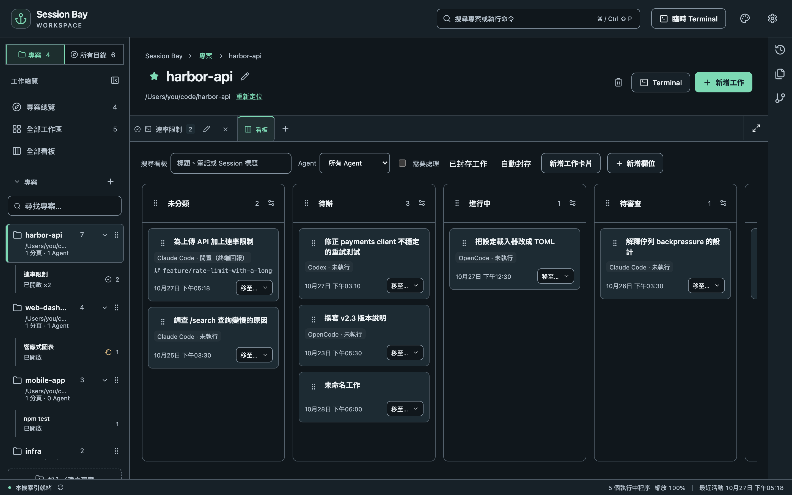
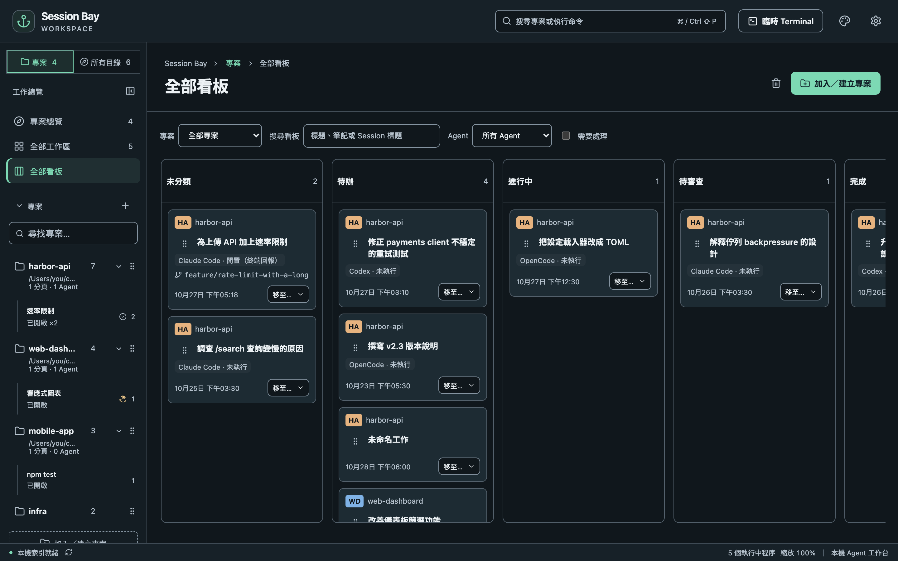

## 啟用專案看板

從**專案**開啟專案，選擇工作區分頁旁的**看板**，再按**啟用看板**。只有加入「專案」的目錄能啟用看板；若目錄只出現在「所有目錄」，請先將它加入專案。

每張卡片代表一項工作，可以附加零個或多個 Agent Sessions。按**新增工作**即可在啟動 Agent 前先規劃。啟用看板後，新的 Sessions 會進入**未分類**；較舊的歷史紀錄維持原狀，直到你接續執行，或從工作詳情使用**從歷史附加**。子 Sessions 會跟隨父 Session 所屬的工作。

看板資料只儲存在 Session Bay 的本機目錄資料庫，重建索引後仍保留，不會寫入專案資料夾或 Agent 歷史紀錄。

## 欄位、階段與移動

預設欄位是**未分類**、**待辦**、**進行中**、**待審查**與**完成**。使用**新增欄位**或欄位設定，可以重新命名、排序、新增欄位與選擇階段。未分類與完成是系統欄位：可以重新命名與排序，但階段固定，且不能刪除。刪除其他欄位前，必須先選擇所有工作（包含已封存工作）的目的地。

拖曳卡片可以排序或移至其他欄位；也能使用卡片的**移至…**選單，不必拖曳。在卡片的拖曳把手上，按 **Alt+上／下方向鍵**調整順序，按 **Alt+左／右方向鍵**切換欄位。按 **Escape** 取消拖曳。

移動完全由你決定。Agent 完成一輪回覆，不會自動把工作移到完成。

## 工作詳情與 Sessions

點選工作標題，即可編輯標題與備註、附加較舊的 Session，或接續附加的 Session。開始工作前，請先儲存變更。

**開始工作**會在專案資料夾或工作綁定的 worktree 開啟現有的 Agent／Shell 啟動介面。終端機提供安全貼上模式後，工作標題與備註會插入輸入區，**不會送出**；請先檢查再按 Enter。若無法使用安全貼上模式，可以改按**複製工作內容**。一般 Shell 不會建立可索引的 Agent Session。

在專案看板中，將卡片拖曳到另一張卡片中央，或在詳情中選擇目標，即可合併工作。請檢查確認內容：Sessions 與備註會移至目標工作，來源工作會刪除。附加的 Session 也能透過**拆分為新工作**再次分開。合併不會跨越專案。

連結的 worktree 中的 Sessions 屬於主專案看板，並顯示分支。工作詳情的**建立 worktree**會將新 checkout 綁定至該工作，之後在其中啟動的 Sessions 會自動附加。

## 全部看板

從側邊欄**全部工作區**下方選擇**全部看板**，即可在五個固定階段欄位中查看每個已啟用專案看板的工作。專案自訂或重新命名的欄位會依階段分組。每張卡片都顯示專案顏色、縮寫與名稱。

可依**專案**、文字、**Agent** 與**需要處理**篩選。文字搜尋包含工作標題、備註與附加 Session 的標題。「需要處理」使用附加 Sessions 的即時狀態，包含等待輸入／權限與錯誤。四種篩選可以一起使用。

將卡片拖曳到另一階段、使用**移至…**，或在把手上按 **Alt+左／右方向鍵**，卡片就會移至**所屬專案依欄位順序第一個符合該階段的欄位**，接在既有工作之後。若專案沒有該階段的欄位，便無法選擇該目的地。拖曳到其他專案的卡片上，也只會改變階段，不會合併卡片或更改工作的專案。

總覽也能開啟詳情、開始工作與接續 Session。調整欄位或欄內卡片順序，請使用專案看板。

## 完成、封存與清理

已完成的工作有三種獨立動作：

- **封存工作**：隱藏工作並保留 Sessions。在專案看板開啟**已封存工作**，即可還原。
- **刪除工作**：移除卡片，並讓你選擇將 Sessions 返回未分類，或從看板移除；歷史紀錄不變。
- **將附加的 Sessions 移至資源回收筒…**：使用既有的逐一確認流程。回收的 Sessions 會從工作中隱藏，還原後會再次出現。

專案看板中的**自動封存**可設定：已完成工作在指定天數內沒有工作內容變更後自動封存，預設關閉。全部看板不顯示已封存工作。

若確認 Session 的來源已消失，或 Session 已移至系統垃圾桶，其連結會移除；即使沒有剩下任何 Session，工作仍會保留。這些看板操作都不會改寫 Agent 歷史紀錄。
