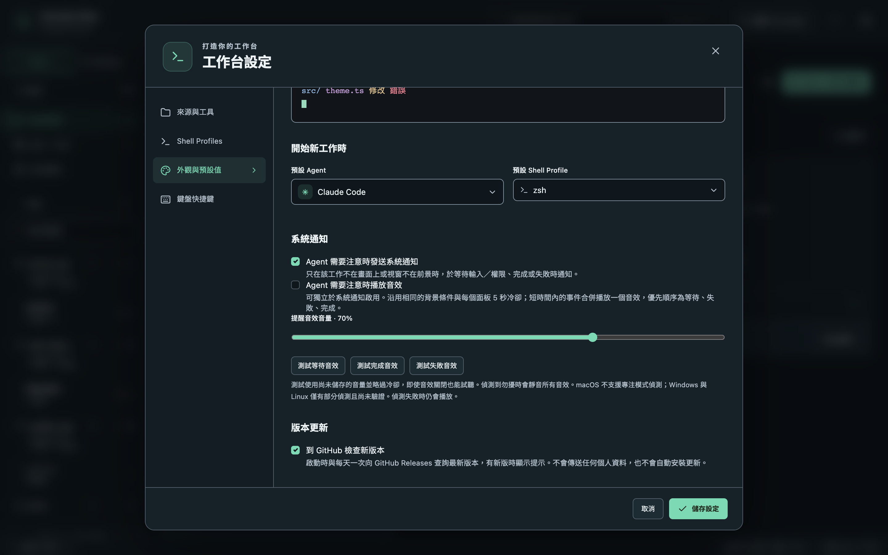

按頂列的齒輪圖示打開**設定**。

## 來源與工具

每個 Agent 有自己的設定：

- **啟用**你用到的 Agent。停用的 Agent 會保留已索引的歷史，但不會掃描或啟動。
- **執行檔路徑**：Session Bay 會檢查 `PATH` 與常見安裝位置，macOS 也包含 nvm、fnm、volta、mise、asdf 與 bun。安裝 CLI 後可按**重新偵測**；若仍找不到，請填入絕對路徑。
- **參數與權限**：以 JSON 陣列填入額外啟動參數，例如 `["--model", "your-model"]`。略過權限確認的高風險模式預設關閉，必須逐一為 Agent 啟用。
- **歷史資料來源**：讀取歷史的資料夾。**偵測歷史來源**會檢查官方已知位置。

## Shell Profiles

設定新終端機使用的 Shell、參數與環境變數。

## 外觀與預設值

- **語言**：English、繁體中文，或跟隨系統語言。切換時會重新載入視窗，終端機會自動重新連線。
- 介面與終端主題、色系、字型，以及工作台縮放（<kbd>⌘</kbd><kbd>+</kbd>／<kbd>⌘</kbd><kbd>-</kbd>／<kbd>⌘</kbd><kbd>0</kbd>）。
- **新增工作**時預設的 Agent 與 Shell Profile，以及系統通知。
- **版本更新**：啟動時與每天一次檢查 GitHub Releases 是否有新版本。不會自動安裝更新。

## 提醒通知與音效

在**外觀與預設值 → 系統通知**中，可以分別啟用系統通知與 **Agent 需要注意時播放音效**。音效**預設關閉**。**提醒音效音量**範圍是 0–100%（預設 70%），設為 0 即靜音。

等待、完成與失敗各有不同音效。只有面板不在畫面上或視窗在背景時才提醒，每個面板共用 5 秒冷卻。1.5 秒內的音效事件會合併播放一個音效，優先順序為**等待、失敗、完成**；符合條件的系統通知仍會分別送出。

使用**測試等待音效**、**測試完成音效**與**測試失敗音效**試聽。測試使用尚未儲存的音量，即使音效關閉也可試聽，並略過可見狀態與冷卻限制，但仍遵守已偵測到的勿擾模式。按**儲存設定**後，音效開關與音量才會套用至 Agent 事件。若沒有聲音，請在程式內點擊、按鍵或使用測試按鈕，以允許音訊播放。

### 勿擾模式的限制

- **macOS**：不支援專注模式偵測，程式內音效可能在專注模式期間播放。
- **Windows 與 Linux**：僅有部分偵測且尚未驗證，部分勿擾模式下仍可能播放音效；Linux 只偵測 GNOME 與 KDE 的相關訊號。
- 若無法偵測或偵測失敗，仍會照常播放音效。已偵測到的勿擾模式也會將測試音效靜音。系統通知仍由作業系統的通知設定控制。

尚未驗證 macOS、Windows 或 Linux 原生 WebView 在背景與最小化時的音效播放。需要安靜時，請關閉音效開關。

## 鍵盤快捷鍵

修改常用命令的快捷鍵。`Mod` 在 macOS 代表 <kbd>⌘</kbd>。
