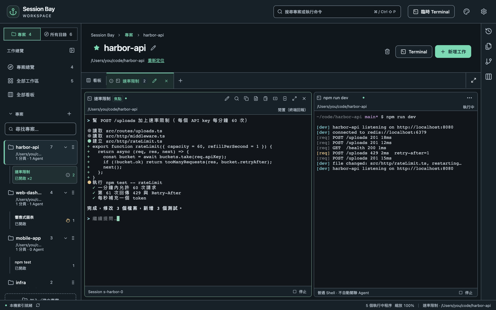
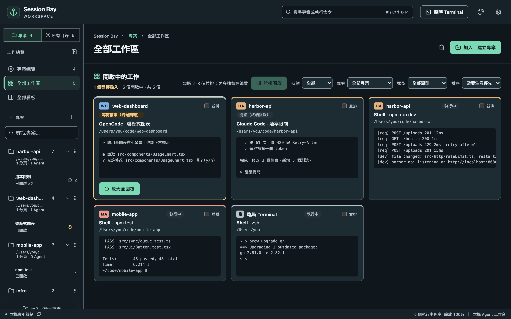

## 開始工作

在專案中按**新增工作**，然後選擇：

- **Agent**：開始一段新的 Agent 對話；或
- **Shell**：用你的 Shell Profile 開一般終端機。

啟動 Agent 前，對話框會顯示實際使用的指令與資料夾。

**Terminal** 會直接開一個 Shell。頂列的**臨時 Terminal** 會在家目錄開 Shell，不需要專案。

## 分割與排列

- 用面板上的按鈕做**左右分割**或**上下分割**。
- 拖曳分隔線調整大小，或用面板上的最大化按鈕。
- 分頁可以拖曳排序、重新命名；<kbd>⌘</kbd><kbd>1</kbd>–<kbd>9</kbd> 切換分頁。
- 分割時選**既有工作**，可以把其他分頁的面板移進來，或直接在分割中接續某個 Session。

## 關掉視窗，工作繼續

終端機屬於背景程序（broker），不屬於視窗。關閉 Session Bay 後，Agent 和開發伺服器會繼續執行；重新打開時，每個面板都會附接回原本的程序，並顯示最近的輸出。

終端機最多保留 **10,000 行捲動歷史**。重新附接時會還原目前畫面，以及最多 **1 MiB 的最新捲動歷史輸出**；較舊的輸出可能已無法查看。

- **停止**會結束面板的程序。關閉面板前會先詢問。
- 電腦重新開機後，面板會顯示**程序中斷**，準備好時再重新啟動即可。

## 把檔案與圖片交給 Agent

把檔案或圖片拖到 Agent 面板上，或直接貼上，就能交給 Claude Code、Codex、Grok Build 或 OpenCode。路徑只會插入、不會送出，你可以先補充需求再按 Enter。

## 一次看全部

側欄的**全部工作區**會列出所有專案中開著的面板與最新輸出，需要你處理的 Agent 排在最前面。

